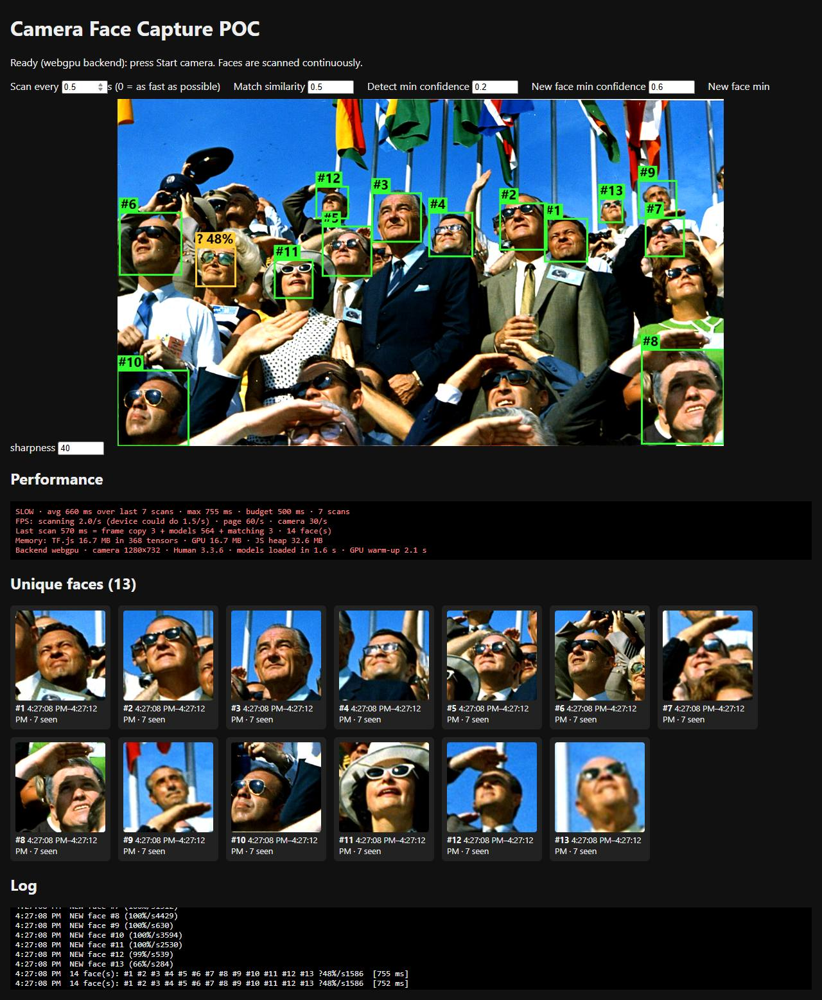
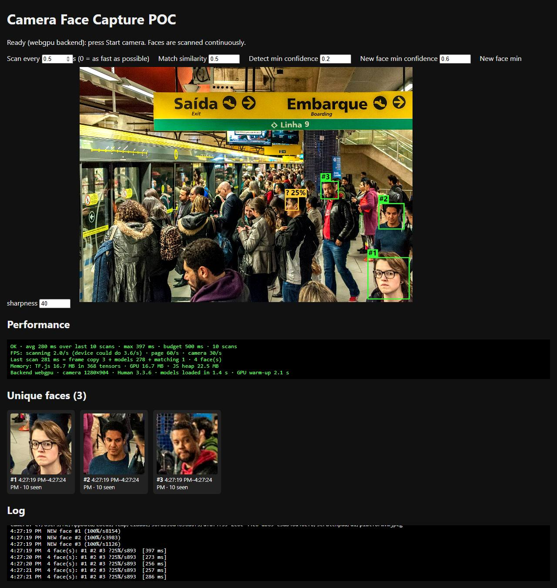
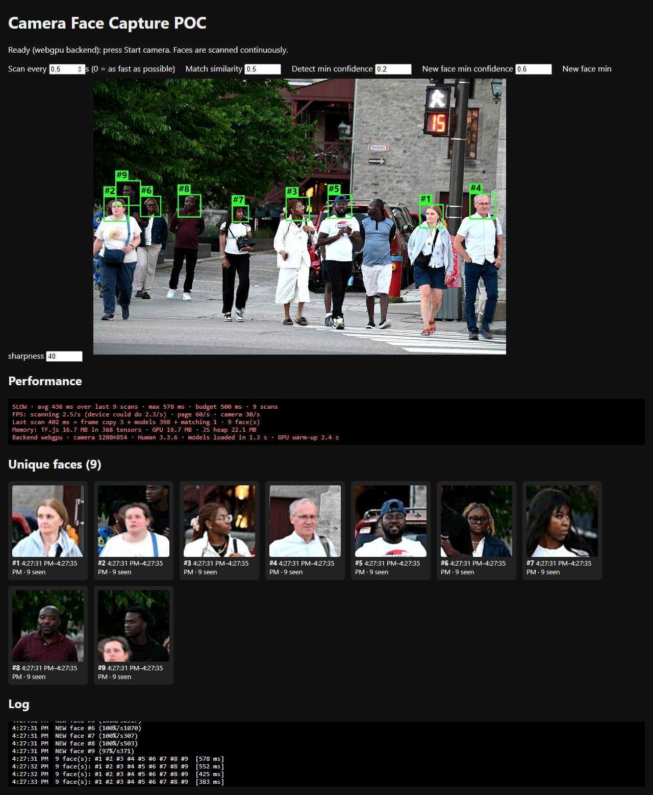
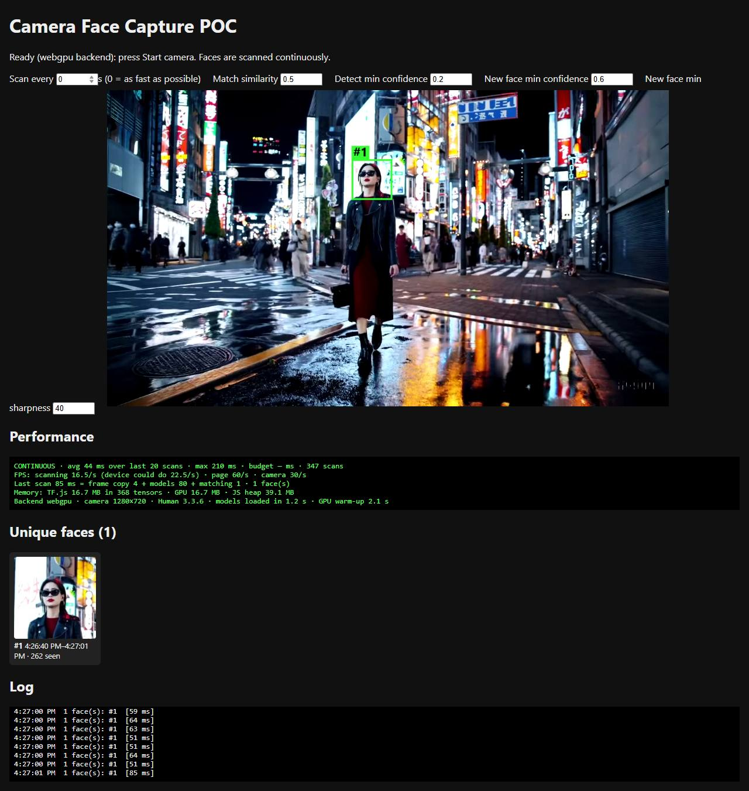
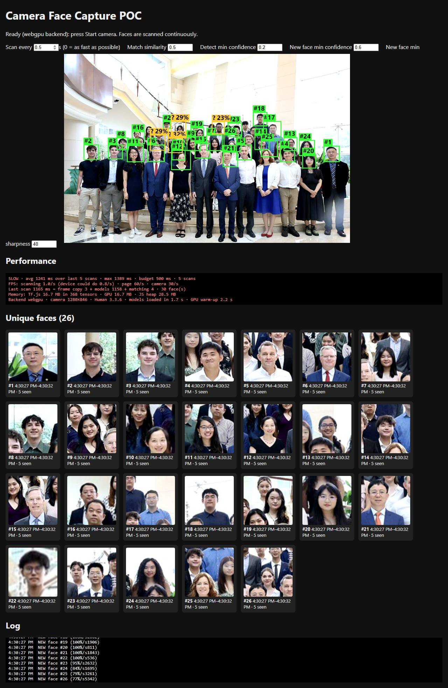
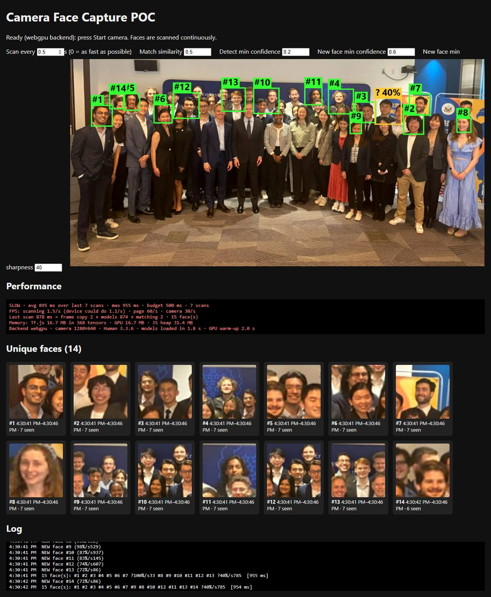
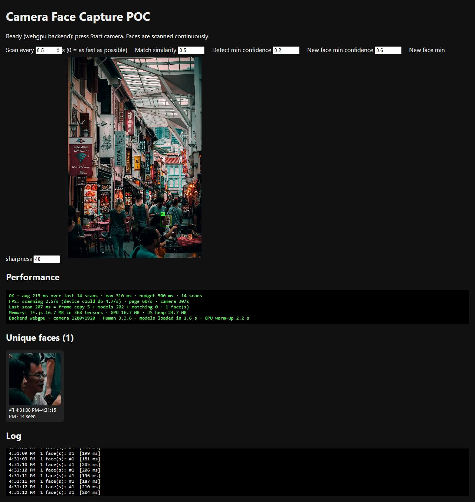
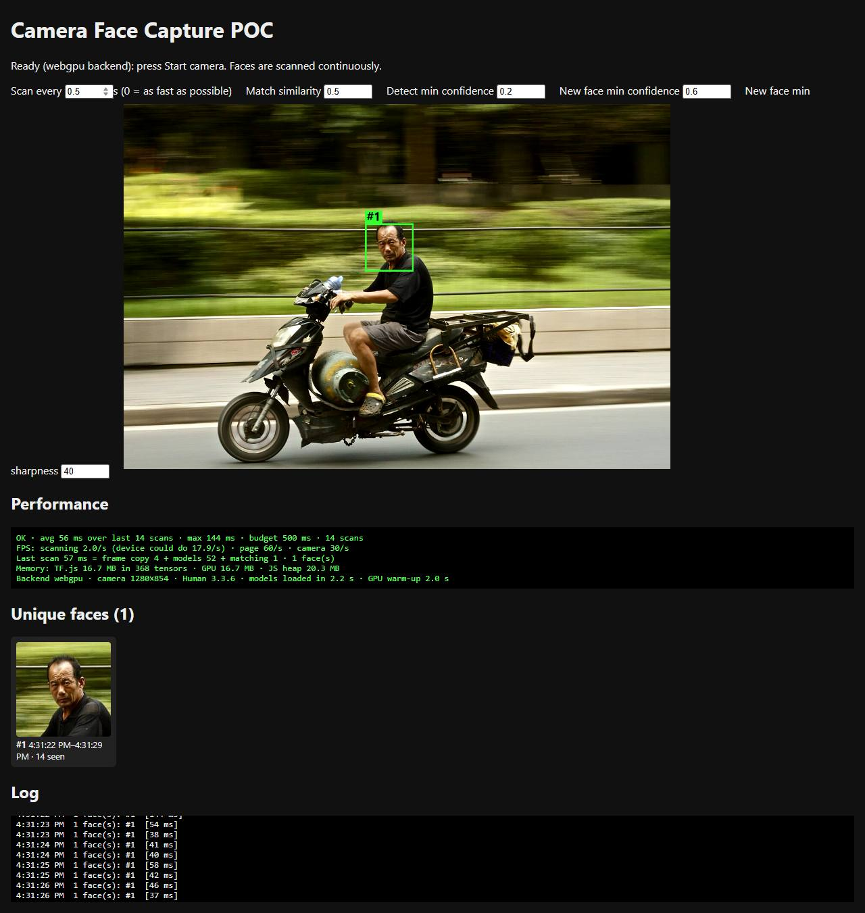
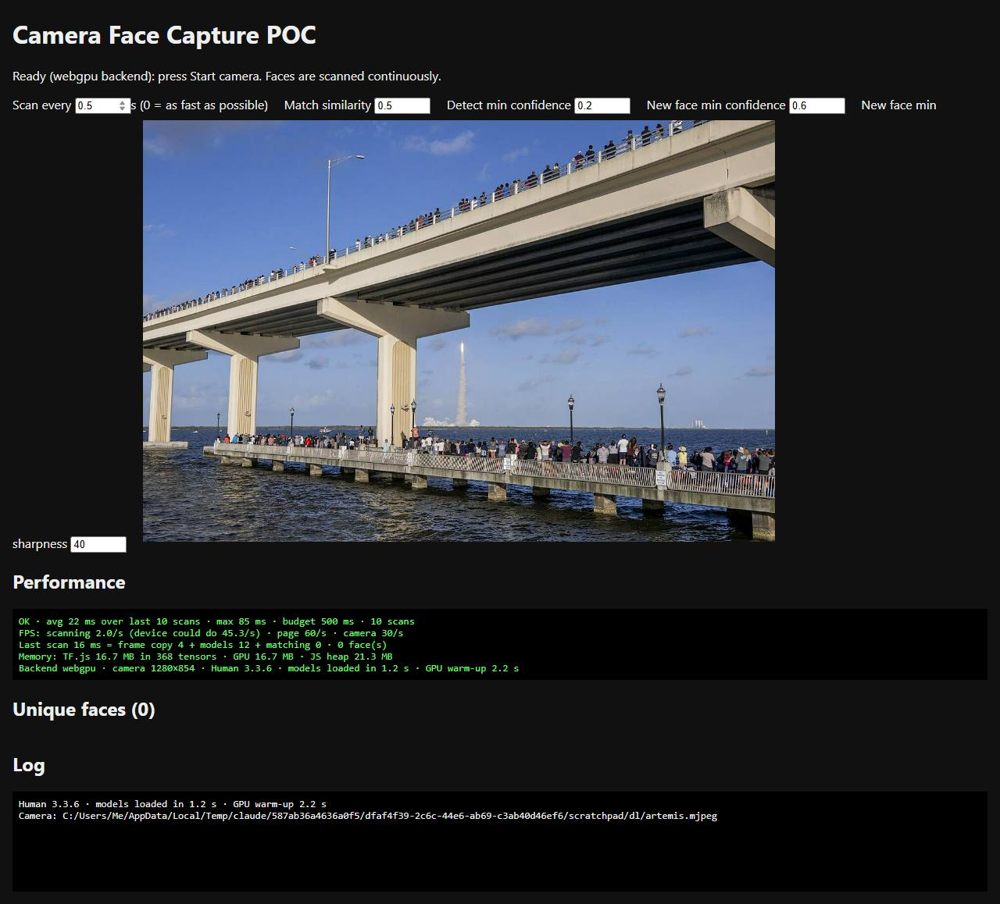

# Camera Face Capture POC

A single static page (`index.html`). It opens the device camera (with a picker if there are several), finds faces in the live feed, saves one snapshot for each unique person and logs every time that person is seen. Everything runs in the browser. Nothing is uploaded.

**Live demo:** https://cheokjiade.github.io/video-face-detection/

## How it works

1. While the camera runs, the page copies the current frame onto a canvas every *N* seconds (0.5 s by default; 0 means as fast as the device can go).
2. It runs three models from [`@vladmandic/human`](https://github.com/vladmandic/human) 3.3.6 on that frame:
   - MediaPipe BlazeFace finds the faces.
   - MediaPipe FaceMesh lines each face up, using 468 points.
   - HSE FaceRes turns each face into a 1024-number descriptor.
3. It matches each face to a card in two steps. It saves a cropped snapshot as a new unique face only when neither step finds one.
   - **Tracking first:** a face whose box centre is within 0.8 box widths of a card seen in the last 2.5 s belongs to that card, closest pairs first. Box overlap (IoU) was too strict: in a crowd walking toward the camera, faces moved about half a box width between scans. Each card takes at most one face. This step doesn't use the descriptor. Masked or low-resolution faces look alike to the descriptor model: in a dense masked crowd, different people in the same frame had a median similarity of 0.63, and 85% of pairs were above 0.5. A loose descriptor match let the first few cards absorb nearly everyone.
   - **Strict re-find:** a face that tracking can't place (someone who walked back in, or was hidden for a moment) is compared with the other cards' descriptors, using Human's similarity score (0 to 1). It joins the best card only if the score is at least the "Re-find similarity" (default 0.8) *and* at least 0.05 above the next-best card (a near-identical score of 0.95 or more is accepted without the margin: otherwise a person who already has two cards can never be re-found, and gets a third). The log marks these as `#id~0.85`.
   - **Why 0.8:** each Apollo 11 astronaut in the crew photo scored 0.61, 0.68 and 0.86 against their own separate NASA portrait, and different people 0.18–0.40, so 0.5 worked for clear faces. In the masked crowd, the same person scored a median 0.91 across consecutive frames, but different people still reached 0.8 in 9% of pairs. A re-find has to beat that.
   - **Starting a new face:** a face only becomes a new card if the detection is at least 80% confident and the crop is sharp enough. Sharpness is the variance of the Laplacian on a 64×64 grey crop; the default minimum is 40. Detector confidence stays at 95–100% even on blurred faces, so confidence alone can't filter out blur. With face-api's tighter crops, a sharp photo scored about 2,700–3,900, Gaussian blur of radius 2 about 90, and radius 3 or more under 30. With Human, the sharp photo scores about 4,700–5,800; at blur radius 2–3 faces are still accepted, and at radius 6 they are rejected (sharpness about 29). The log shows each face's `confidence%/sSharpness` so you can tune the limits.
   - **One match per frame:** within a single frame, each known face can match only one detection. Blurred faces of different people look alike, and without this rule they would merge into one card.
   - **Several views per person:** each card keeps up to 20 descriptors from noticeably different views (near and far, head turned). A new sighting matches the card if it is close to *any* of them. With only one descriptor per card, a woman walking toward the camera in the Tokyo test video was split into two cards as her face grew and turned. A view is only added from a tracked sighting or a strict re-find. A tracked sighting is trusted even when its descriptor score is low, which is exactly when a new view is worth keeping. Adding views from loose matches let one card absorb several look-alike (masked) people: each wrong match made the next one easier.
   - **Forgetting:** a card not seen for "Forget after (min)" minutes (default 5; 0 = never) is no longer matched, and its descriptors are freed. If that person comes back, they get a new card. This keeps matching fast in long sessions. The unique-face count still includes forgotten cards. The page shows the 200 most recent cards and the last 500 log lines.
   - **Doubled boxes:** the detector sometimes returns two boxes for one face. Any box whose centre lies inside a higher-scoring box is dropped. Before this rule, a doubled box created a duplicate card in the Tokyo test.
   - **Best snapshot:** every card shows its sharpest sighting.
   - **Detection cut-off** ("Detect min confidence", default 0.2): faces scoring below this are ignored entirely. In the crowd tests, 0.2 found about twice as many faces as 0.5, and each scan took about twice as long. A new card still needs at least 0.6 confidence; faces between 0.2 and 0.6 can only match existing cards.
4. **Boxes over the live video:** after each scan, every face gets a box. Green with `#id` means it matched or created that card. Yellow with `? NN%` means the face was too uncertain or blurry to start a card. The boxes come from the last scan, so at a 0.5 s interval they trail people who are moving. Set the interval to 0 for near-live boxes.
5. A **Performance** panel updates after every scan. It shows:
   - **OK/SLOW/CONTINUOUS**: whether scans take more than 60% of the scan interval, judged on the average of the last 20 scans (so it catches slowdown from heat). CONTINUOUS means the interval is 0.
   - **Worst scan** and total scan count.
   - **FPS**:
     - **Scanning**: scans actually completed per second.
     - **Device could do**: the scan rate the device could reach (1000 ÷ average scan time).
     - **Page**: screen refreshes per second. If this drops, the page is janky.
     - **Camera**: the frame rate the camera is delivering.
   - **Last scan split into steps**: copying the frame, running the models, and matching faces.
   - **Memory**:
     - **TensorFlow.js memory and tensor count**: if this keeps growing, memory is leaking.
     - **GPU memory**.
     - **JavaScript heap**: Chromium browsers only.
   - **System info**: backend, camera resolution, Human version, model load time and GPU warm-up time.
6. Right after loading, the page runs `human.warmup()` once. The GPU compiles its programs on a model's first run, which took about 15 s in testing with face-api, so this keeps the first camera scan from freezing.

**Backend:** Human picks one automatically. It prefers **WebGPU** where the browser supports it, and falls back to WebGL. To force one for comparison, add a URL parameter: `?backend=webgl` or `?backend=webgpu`.

To run it locally, run `npx serve` and open the localhost URL. The camera needs HTTPS or localhost, so opening the file directly may not work. The models load from the jsDelivr CDN.

## Test results

These tests use public-domain and CC0 images from Wikimedia Commons, fed to Edge as a simulated camera (`--use-file-for-fake-video-capture`) on the desktop test PC. Settings are the defaults unless noted.

| Test | People visible | Faces found / cards | Scan time | Notes |
|---|---|---|---|---|
| [Apollo 11 VIP spectators](https://commons.wikimedia.org/wiki/File:Spiro_Agnew_and_Lyndon_Johnson_Watch_the_Apollo_11_Liftoff_-_GPN-2002-000068.jpg) (NASA, public domain) | ~25 | 14 / 13 | ~660 ms (SLOW) | Faces tilted up, sunglasses and hands over eyes. 1 found face was too uncertain for a card |
| [Metro platform at rush hour](https://commons.wikimedia.org/wiki/File:Evening_rush_on_the_Line_4-Yellow_platform_at_Pinheiros_station,_S%C3%A3o_Paulo.jpg) (CC0) | ~15 clear, many more distant | 4 / 3 | ~280 ms | Small and partly hidden faces are missed |
| [Pedestrians on a crosswalk](https://commons.wikimedia.org/wiki/File:Pedestrians_crossing_rue_Dalhousie,_Quebec_City_01.jpg) (CC0) | 11 | 9 / 9 | ~430 ms (SLOW) | 2 people seen side-on were missed |
| [Sora "Tokyo Walk" video](https://commons.wikimedia.org/wiki/File:OpenAI_Sora_in_Action-_Tokyo_Walk.webm) (AI-generated, public domain), interval 0 | 1 main, background crowd | 1 card over 347 scans | ~45–65 ms, ~16 scans/s | One person tracked as one card for 20 s while walking toward the camera |
| [Fudan University group photo, Shanghai](https://commons.wikimedia.org/wiki/File:Ambassador_Burns_and_students_from_Fudan_University_and_Harvard_pose_for_group_photo_in_Shanghai.jpg) (U.S. State Dept, public domain) | ~45 | 30 / 26 | ~1,240 ms (SLOW) | Back rows partly hidden behind people in front. 4 found faces too uncertain for a card |
| [Yenching Academy group photo, Beijing](https://commons.wikimedia.org/wiki/File:Group_photo_of_Ambassador_Burns_with_students_from_the_Yenching_Academy_of_Peking_University.jpg) (U.S. State Dept, public domain) | ~50 | 15 / 14 | ~895 ms (SLOW) | Wide shot, so faces are small (about 20–30 px) |
| [Chinatown street market, Singapore](https://commons.wikimedia.org/wiki/File:Chinatown_street_market_(Unsplash).jpg) (CC0) | ~10 | 1 / 1 | ~210 ms | Most people are side-on, facing away or small |
| [Scooter rider, Shanghai](https://commons.wikimedia.org/wiki/File:Shanghai,_China_(Unsplash_lohK4mWig70).jpg) (CC0) | 1 | 1 / 1 | ~56 ms | Motion-blurred background did not cause problems |
| [Street intersection, Hong Kong](https://commons.wikimedia.org/wiki/File:Crowded_Asian_intersection_(Unsplash).jpg) (CC0) | ~30, distant | 0 | ~20 ms | Pedestrians too far away |
| [Distant crowd on a bridge](https://commons.wikimedia.org/wiki/File:Artemis_II_launch_from_A_Max_Brewer_Bridge_(AFRC2026-0071-03).jpg) (NASA, public domain) | hundreds | 0 | ~20 ms | Faces are a few pixels across. Too small to detect |

**What this shows:**
- **Faces need about 30–40 px or more** in the camera frame. BlazeFace scales every frame down to 256×256, so small and distant faces are lost. Splitting the frame into 2×2 tiles was tested and added only 1–6 faces at 2–4 times the cost, so it isn't enabled.
- **Faces must point roughly at the camera.** Faces seen side-on, looking up, or covered by hands or sunglasses are often missed.
- **Scan time grows with the number of faces**, because every face gets alignment and a descriptor. With 9–14 faces the desktop PC can't keep up with a 0.5 s interval, and the panel shows SLOW. For crowds, use a 1 s interval.
- **Duplicate removal held in every test** after the two fixes above (several views per person, dropping doubled boxes), including 26 cards for 26 people in the Fudan group photo.

### Performance with multiple people

**Desktop test PC** (Edge, WebGPU, 1280-wide frames). Each row is the average over a run of scans of one image:

| Faces found in frame | Scan time | Scans per second it could do | Test |
|---|---|---|---|
| 1 | ~45–65 ms | ~16–20 | Tokyo walk video, Shanghai scooter rider |
| 3 | ~130–150 ms | ~7 | Apollo 11 crew portrait |
| 4 | ~280 ms | ~3.5 | Metro platform |
| 9 | ~430 ms | ~2.3 | Quebec City pedestrians |
| 14 | ~660 ms | ~1.5 | Apollo 11 VIP spectators |
| 15 | ~895 ms | ~1.1 | Yenching Academy group |
| 30 | ~1,240 ms | ~0.8 | Fudan University group |

- **Rule of thumb:** about **20 ms per scan plus 40 ms for each face** on this PC. Every face needs its own alignment (FaceMesh) and descriptor (FaceRes) run. Finding the faces costs about the same whatever the count.
- **Some scans cost more than their visible faces suggest.** The Singapore market scan took about 210 ms for 1 card. The detector also produced low-scoring candidates that went through alignment before being dropped.
- **What a 0.5 s interval can handle:** up to about **10 faces** on this PC. Beyond that the panel shows SLOW and scans simply run back to back. Nothing breaks, but the effective rate drops, e.g. to about 0.8 scans/s with 30 faces.
- **Phones:** on a single face the iPhone 15 Pro scanned in about 45–88 ms, against about 45–65 ms on this PC. So the per-face cost there is likely similar or a little higher. Crowds on a phone haven't been measured yet; a group-photo test on the iPhone would settle it.
- **For groups:** use a 1 s interval, or raise "Detect min confidence" to skip the uncertain faces. Each skipped face saves about 40 ms.

### Screenshots

**Apollo 11 VIP spectators:** green boxes are cards; the yellow box was too uncertain to start a card.

**Metro platform:** only the larger faces near the camera are found.

**Pedestrians on a crosswalk:**

**Sora Tokyo walk video:** one person, one card, 347 scans.

**Fudan University group, Shanghai:** 30 faces found, 26 cards, no duplicates. The back rows are partly hidden.

**Yenching Academy group, Beijing:** wide shot, so many faces are too small.

**Chinatown market, Singapore:** most people are side-on or facing away.

**Scooter rider, Shanghai:**

**Distant crowd:** faces are too small to detect.

## Hardware requirements

> **The device table below contains estimates.** To measure a real device, open the page on it and read the Performance panel.

**Measured with Human (current version):**

- **Desktop Edge**, on a 1280×1006 image of 3 faces:
  - **WebGPU**: averaged 135 ms per scan, worst 169 ms. GPU warm-up took 2.1 s.
  - **WebGL**: averaged 231 ms per scan, worst 513 ms. GPU warm-up took 2.9 s.
  - TensorFlow.js memory: 16.7 MB.
- **iPhone 15 Pro** (Chrome on iOS; WebGPU; 720×1280 camera):
  - Averaged 45 ms per scan, worst 88 ms, over 169 scans. The device could scan about 22 times per second.
  - The last scan had 0 faces (models 39 ms), and the 20-scan average includes scans with no faces. Scans with a face in frame are probably nearer the 88 ms worst case.
  - Memory: 16.7 MB, flat. GPU warm-up: 1.8 s.
  - 2 people were captured as 2 unique faces, with no duplicates.
- **Human is about twice as fast as face-api on the iPhone** (WebGPU vs WebGL), even though it is slower on the desktop test PC (about 135 ms vs 55–100 ms). Human's alignment does more work per face (468 points instead of 68), but WebGPU more than makes up for that on the iPhone.
- **The MacBook Air M4 still needs re-measuring** with Human.

**Measured with face-api (the previous version, for comparison):**

- **iPhone 15 Pro** (Chrome on iOS, so the WebKit engine; WebGL; 720×1280 camera, 1 face):
  - Averaged 109 ms per scan, worst 135 ms, over 72 scans (models about 114 ms, frame copy about 6 ms).
  - Memory: 44 MB. GPU warm-up: 0.8 s.
- **MacBook Air M4** (WebGL; 1280×720 camera, 1 face):
  - Averaged 81 ms per scan, worst 98 ms, over 38 scans (models about 58 ms, frame copy about 12 ms).
  - Memory: 44 MB. GPU warm-up: 2.3 s.
- **Desktop Edge** (WebGL; 1280×1006 image of 3 faces):
  - Averaged 55–100 ms per scan.
  - Memory: 44 MB. GPU warm-up: 1.3 s with the shader cache already filled; the first-ever run took about 15 s.

**What "smooth" means here:** each scan has to finish faster than the scan interval. With the default 0.5 s interval, a scan time under about 300 ms leaves room for the camera preview to stay smooth.

**Cost of one scan:** one face detection on the frame, plus alignment and a descriptor for *each* face. More faces in the frame means a longer scan.

| Device (released in the last 2 years) | Expected scan time (1–3 faces) | Verdict at 0.5 s interval |
|---|---|---|
| Laptop, Apple M-series or Intel Core Ultra / AMD Ryzen 7000+ with integrated GPU | ~50–150 ms | Smooth. Can scan every 0.2 s |
| Laptop with a discrete GPU | ~20–80 ms | Smooth |
| Flagship phone (iPhone 15/16, Pixel 8/9, Galaxy S24/S25) | ~100–300 ms | Smooth |
| Mid-range phone (e.g. Galaxy A5x, Pixel 8a) | ~250–600 ms | Usable. Set the interval to 1 s |
| Budget phone (under ~$200) | 600 ms–2 s+ | Choppy. Use a 1–2 s interval, or move detection to a server |

**Minimum requirements:**
- **Browser:** a current version of Chrome, Edge, Safari or Firefox with WebGPU or WebGL2. The Performance panel shows the backend; `cpu` will be very slow.
- **RAM:** about 200–400 MB for the browser tab. 4 GB of system RAM is enough. On phones, close other apps.
- **Download:** about 9 MB of model files on first load (FaceRes 6.7 MB, FaceMesh 1.5 MB, BlazeFace 0.5 MB), plus the Human library itself. After that the browser caches them.
- **Camera:** the page asks for 1280px wide. Every scan copies the full frame, so higher resolutions cost more memory and copy time and can stutter on phones.
- **Long sessions on phones:** the GPU running for a long time causes thermal throttling. Expect scans to get 1.5–2 times slower after a few minutes.

**When to move to a server:** if the target is low-end phones, or many faces per frame (crowds), run only face *detection* on the device (or none at all), and send the frames or crops to the planned API for the descriptor step.

## License report

> This is an engineering summary, not legal advice. Have counsel review it before any commercial or production use.

### Code and libraries

| Component | License | Notes |
|---|---|---|
| [`@vladmandic/human`](https://github.com/vladmandic/human) 3.3.6 | MIT | Maintained; last updated Dec 2025. It replaced [`@vladmandic/face-api`](https://github.com/vladmandic/face-api), which was archived in Feb 2025 |
| TensorFlow.js (bundled inside Human's `dist`) | Apache-2.0 | Keep the NOTICE/license if you redistribute it |
| This repository's own code | **No license chosen yet** | Without a LICENSE file, others may view the code but have no right to reuse it. Add MIT (or similar) if you want that. |

MIT and Apache-2.0 both allow commercial use. Their only real requirement is keeping the copyright and license notices.

### Model weights (the riskier part)

| Model | Source | License / status | Commercial risk |
|---|---|---|---|
| BlazeFace (finds faces) | Google MediaPipe | Apache-2.0 | Low |
| FaceMesh (aligns faces) | Google MediaPipe | Apache-2.0 | Low |
| FaceRes (descriptor) | [HSE_FaceRec_tf](https://github.com/av-savchenko/HSE_FaceRec_tf), Higher School of Economics | Repo is Apache-2.0. Identity training used **VGGFace2**: faces scraped from Google Images, and Oxford no longer distributes it. The author's combined age/gender models also used **UTKFace**, which is licensed for non-commercial research only | **Medium.** The code license is permissive, but the training data is scraped faces, and part of it is research-only. Whether dataset terms carry over to trained weights is legally unsettled |

**Compared with face-api:** finding and aligning faces is now clean (Apache-2.0, from Google). The landmark model with unknown training data, and the detector trained on research-use data, are both gone. The remaining question is the descriptor's training data.

**For commercial use**, either:
- get legal sign-off on FaceRes, or
- use a descriptor model trained on licensed or synthetic data, or a commercial SDK.

Human can also load MobileFaceNet or InsightFace instead of FaceRes, but InsightFace's pretrained weights are explicitly non-commercial.

### Laws on biometric data (more important than the software licenses)

Face descriptors count as **biometric data** in most places, even inside a POC once real people's footage is used:
- **EU/UK GDPR, Art. 9:** processing to identify people is a "special category". It needs explicit consent or another Art. 9 basis, plus a DPIA.
- **Illinois BIPA:** needs written consent and a retention policy. Individuals can sue for $1k–$5k per violation. Texas and Washington have similar laws.
- **Singapore PDPA:** consent and notification apply to facial images, and so does the guidance on biometric identification.
- **EU AI Act:** *real-time* remote biometric identification in public spaces is heavily restricted, and scraping faces to build recognition databases is prohibited.

**Why this POC is low-risk today:**
- Everything stays in the browser tab and nothing is stored or sent anywhere.
- It only groups faces *within one session*; it doesn't match them against a known identity database.

**This changes once snapshots or descriptors go to the planned API.** At that point you will need consent or notice, a retention limit, and encryption.
